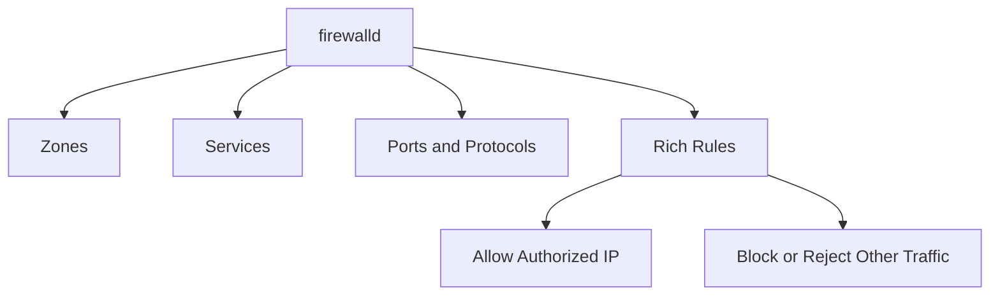

# Firewall Configuration (firewalld)

## Objective

Configure firewalld on RHEL to control network access to the file server.

The objective is to allow only authorized systems to access specific services, particularly NFS and SSH, using source IP-based firewall rules.

## Key Concepts

firewalld manages network traffic using zones, services, ports and rules.

| Concept   | Purpose                                                                 |
| --------- | ----------------------------------------------------------------------- |
| Zone      | Defines a network trust level and associated firewall policy            |
| Service   | Predefined firewall configuration for a network service                 |
| Port      | Allows traffic through a specific port and protocol                     |
| Rich Rule | Creates conditional rules based on source IP, port, protocol and action |

**Rich rules** are used in this implementation to restrict NFS and SSH access to a specific client IP.

## Firewall Architecture



## Network Configuration

The following IP addresses are used in the lab.

| System           | IP Address                         |
| ---------------- | ---------------------------------- |
| RHEL Server      | `192.168.184.137`                  |
| RHEL Client      | `192.168.184.139`                  |
| Server Interface | `ens160` (verify actual interface) |
| Firewall Zone    | `public` (verify active zone)      |

**Command execution guide:**

- **RHEL Server:** All firewalld configuration and firewall management commands.
- **RHEL Client:** Network address verification and connectivity testing.

The firewall rules will be configured on the RHEL Server to control incoming connections from the client.

## Implementation

### 1. Audit Existing Firewall Configuration

Before modifying the firewall, inspect the existing configuration on the server to avoid disrupting currently working services.

**1. Check firewalld status**

Run on: **RHEL Server**

```bash
systemctl status firewalld
```

**2. Identify active zones and interfaces**

Run on: **RHEL Server**

```bash
firewall-cmd --get-active-zones
```

Example output:

```text
public
  interfaces: ens160
```


**3. Inspect runtime configuration**

Run on: **RHEL Server**

```bash
firewall-cmd --zone=public --list-all
```

**4. Inspect permanent configuration**

Run on: **RHEL Server**

```bash
firewall-cmd --permanent --zone=public --list-all
```

**5. Inspect rich rules**

Run on: **RHEL Server**

Runtime rules:

```bash
firewall-cmd --zone=public --list-rich-rules
```

Permanent rules:

```bash
firewall-cmd --permanent --zone=public --list-rich-rules
```

**6. Validate firewall configuration**

Run on: **RHEL Server**

```bash
firewall-cmd --check-config
```

Expected output:

```text
success
```

**Important concepts:**

- Runtime configuration contains currently active firewall rules.
- Permanent configuration stores rules that persist across reloads and restarts.
- `--reload` applies permanent configuration to the running firewall.

### 2. Verify Network Addresses

Before creating IP-specific rules, verify the IP addresses on both systems.

**On RHEL Server:**

```bash
ip -4 -br addr
```

**On RHEL Client:**

```bash
ip -4 -br addr
```

Confirm that the IP addresses match the intended configuration:

```text
Server: 192.168.184.137
Client: 192.168.184.139
```

Do not proceed with IP-specific rules if the addresses have changed.

### 3. Configure Source-Specific Firewall Rules

All commands in this section must be executed on the **RHEL Server**.

The target policy is to allow only the authorized RHEL client to access NFS and SSH.

**Rule 1: Allow NFSv4 from the authorized client**

NFSv4 uses TCP port `2049`.

Run on: **RHEL Server**

```bash
firewall-cmd --permanent --zone=public \
--add-rich-rule='rule family="ipv4" source address="192.168.184.139/32" port port="2049" protocol="tcp" accept'
```

**Rule 2: Allow SSH from the authorized client**

SSH uses TCP port `22`.

Run on: **RHEL Server**

```bash
firewall-cmd --permanent --zone=public \
--add-rich-rule='rule family="ipv4" source address="192.168.184.139/32" port port="22" protocol="tcp" accept'
```

**Understanding the rich rule:**

| Parameter          | Purpose                            |
| ------------------ | ---------------------------------- |
| `family="ipv4"`    | Applies the rule to IPv4 traffic   |
| `source address`   | Specifies the authorized source IP |
| `/32`              | Matches one specific IPv4 address  |
| `port port="2049"` | Matches the NFSv4 port             |
| `port port="22"`   | Matches the SSH port               |
| `protocol="tcp"`   | Matches TCP traffic                |
| `accept`           | Allows matching traffic            |

### 4. Apply Firewall Configuration

First, validate the permanent configuration.

Run on: **RHEL Server**

```bash
firewall-cmd --check-config
```

Expected output:

```text
success
```

Apply the configuration:

Run on: **RHEL Server**

```bash
firewall-cmd --reload
```

### 5. Verify Firewall Rules

Check active rich rules.

Run on: **RHEL Server**

```bash
firewall-cmd --zone=public --list-rich-rules
```

Check permanent rich rules.

Run on: **RHEL Server**

```bash
firewall-cmd --permanent --zone=public --list-rich-rules
```

Inspect the complete firewall configuration.

Run on: **RHEL Server**

```bash
firewall-cmd --zone=public --list-all

firewall-cmd --permanent --zone=public --list-all
```

### 6. Remove Unnecessary Broad Service Allowances

A source-specific rich rule does not restrict other clients if a broad service allowance still permits traffic from all sources.

Therefore, inspect and remove unnecessary broad allowances.

**Check whether NFS service is broadly allowed.**

Run on: **RHEL Server**

```bash
firewall-cmd --permanent --zone=public --query-service=nfs
```

If it is enabled and you are using NFSv4 only, remove the broad NFS service allowance:

```bash
firewall-cmd --permanent --zone=public --remove-service=nfs
```

Validate and reload:

```bash
firewall-cmd --check-config

firewall-cmd --reload
```

**SSH security consideration**

Do not immediately remove the existing broad SSH allowance.

First verify that the source-specific SSH rule works.

Keep your existing SSH session open and test a new SSH connection from the authorized client.

After confirming access and ensuring you have an alternative console or recovery method, inspect the broad SSH allowance:

```bash
firewall-cmd --permanent --zone=public --query-service=ssh
```

If it is enabled and no longer required, remove it:

```bash
firewall-cmd --permanent --zone=public --remove-service=ssh
```

Apply the change:

```bash
firewall-cmd --check-config

firewall-cmd --reload
```

**Important:** Also inspect separately allowed ports, other rich rules and the firewall policy of the active zone. Removing a service does not automatically remove every possible way of allowing that traffic.

### 7. Test Network Access

After applying the firewall policy, verify that authorized clients can access the required services.

**A. NFS connectivity test**

Run on: **RHEL Client**

Make sure the share is not already mounted by fstab or AutoFS before performing a manual mount test.

```bash
mount -t nfs -o vers=4 192.168.184.137:/srv/nfs/shared /mnt/nfs/shared
```

Verify:

```bash
findmnt /mnt/nfs/shared

df -hT /mnt/nfs/shared

ls -la /mnt/nfs/shared
```

**B. SSH connectivity test**

Run on: **RHEL Client**

```bash
ssh <username>@192.168.184.137
```

Replace <`username`> with the actual account configured on the server.

After implementing SSH key-based authentication, verify login using the configured private key.

**C. Unauthorized access test**

When another client system is available, attempt to connect from an unauthorized IP.

Verify that access to the restricted NFS and SSH ports is denied.

Do not use the authorized client IP for this test.

## Important firewalld Commands

| Command                           | Purpose                         | Run on |
| --------------------------------- | ------------------------------- | ------ |
| `firewall-cmd --state`            | Checks firewall state           | Server |
| `firewall-cmd --get-active-zones` | Displays active zones           | Server |
| `firewall-cmd --list-all`         | Displays zone configuration     | Server |
| `firewall-cmd --list-services`    | Displays allowed services       | Server |
| `firewall-cmd --list-ports`       | Displays allowed ports          | Server |
| `firewall-cmd --list-rich-rules`  | Displays rich rules             | Server |
| `firewall-cmd --check-config`     | Validates configuration         | Server |
| `firewall-cmd --reload`           | Applies permanent configuration | Server |
| `ip -4 -br addr`                  | Displays IPv4 addresses         | Both   |
| `mount -t nfs`                    | Mounts an NFS share             | Client |
| `ssh username@server-ip`          | Tests SSH connection            | Client |

## Final Verification Checklist

- [x] firewalld service running on the server.
- [x] Active zone and network interface identified.
- [x] Runtime and permanent configurations inspected.
- [x] Server and client IP addresses verified.
- [x] NFSv4 access rule added for authorized client.
- [x] SSH access rule added for authorized client.
- [x] Firewall configuration validated.
- [x] Permanent rules applied using reload.
- [x] Unnecessary broad NFS allowance removed.
- [x] SSH access tested before removing broad SSH allowance.
- [x] NFS connectivity tested from the client.
- [x] SSH connectivity tested from the client.
- [x] Unauthorized access restrictions tested where possible.

## Outcome

The intended result is a source-restricted firewall configuration on RHEL using firewalld rich rules to control access to NFSv4 and SSH services.

## Evidence

See the [Firewall screenshots](../screenshots/firewalld/) directory for:

- Firewall status and active zones.
- Runtime and permanent configurations.
- Source-specific rich rules.
- NFS connectivity testing.
- SSH connectivity testing.
